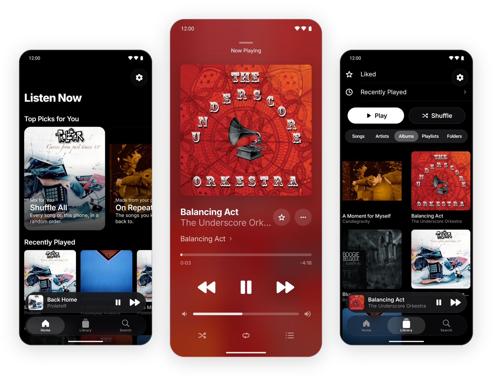
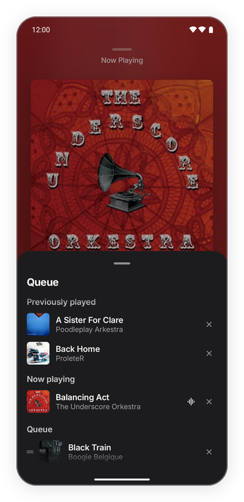
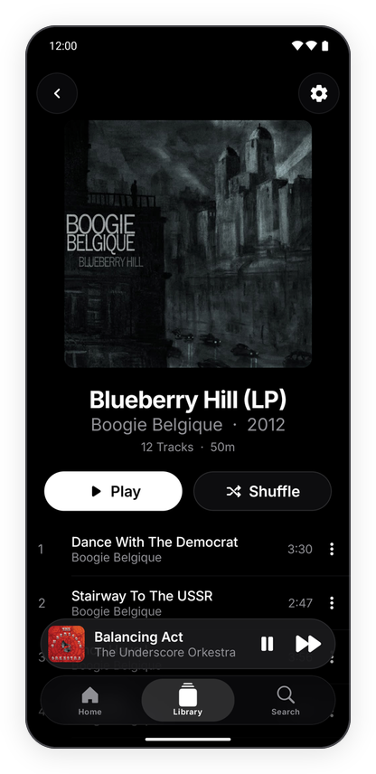
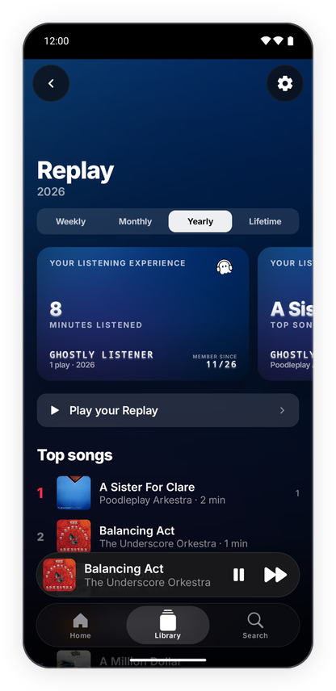
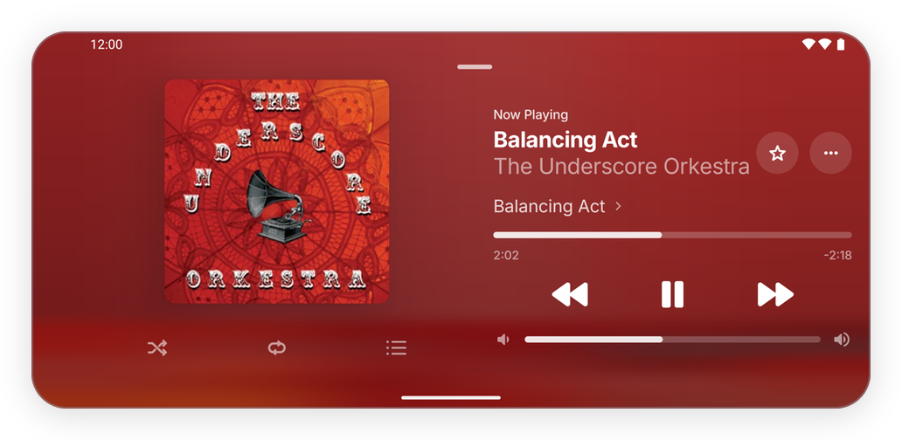

<h1 align="center">Ghostly</h1>

<p align="center">
  A simple, offline music player for Android.<br>
  It plays the audio files on your phone. The only online part is optional Last.fm scrobbling.
</p>

<p align="center">
  <a href="https://github.com/ghostmikz/ghostly/releases/latest"></a>
  
  
  <a href="LICENSE"></a>
</p>

<p align="center">
  <a href="https://github.com/ghostmikz/ghostly/releases/latest"><b>Download the APK</b></a>
</p>

<p align="center">
  
</p>

<p align="center">
  
  
  
</p>

<p align="center">
  
</p>

<p align="center"><sub>Music in the screenshots is Creative Commons, from the Internet Archive netlabels collection:
ProleteR, Boogie Belgique, Candlegravity, Poodleplay Arkestra and The Underscore Orkestra.</sub></p>

## Features

- **BitChord-style design**: floating tab bar and mini player, an Apple Music-like player
  with a backdrop drawn from the cover, light and dark themes, optional Liquid Glass
  tab bar (Android 12+)
- **Listen Now**: mixes and shelves built from your own listening (recently played,
  most played, recently added)
- **Library**: songs, artists, albums, playlists and folders, plus search
- **Playlists**: Liked first, then your own; add songs from any song's menu
- **Player**: shuffle, repeat, queue, "play next", swipe to play next, volume bar,
  sleep timer (after this song, presets or a custom time)
- **Replay**: your top songs, artists, albums and genres, counted on the phone,
  with story cards and a picture you can share
- **Home screen widgets**: 2x2, 4x2 and a 4x1 capsule with Like and Shuffle
- **Last.fm**: sign in with your account, scrobble tracks and show "now playing"
- **Your data**: export and import settings, history, playlists and Replay as one JSON file

## Build

Needs JDK 17+ and the Android SDK. Put this in `local.properties`:

```
sdk.dir=/path/to/Android/Sdk
LASTFM_API_KEY=...
LASTFM_SECRET=...
```

Get the Last.fm key at https://www.last.fm/api/account/create (leave them empty to build without Last.fm).

```
./gradlew assembleRelease   # app/build/outputs/apk/release/app-release.apk
```

## License

GPLv3. The design, icons, Replay, widgets, sleep timer, playlists and Last.fm client are
adapted from [BitChord](https://github.com/kushagrasinghx/BitChord) (GPLv3).
Liquid Glass uses [Kyant0/backdrop](https://github.com/Kyant0/backdrop) (Apache License 2.0),
included in `app/src/main/java/com/ghostmikz/ghostly/ui/backdrop`.
Font: [Inter](https://rsms.me/inter/) (SIL Open Font License).
